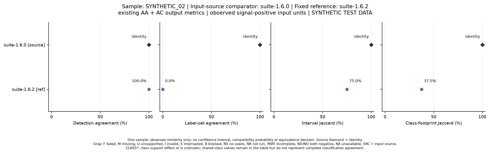

# AmpliconSuite Benchmarks

**Compare version-specific amplification results with bounded computation and explicit statistical evidence.**

[中文说明](README.zh-CN.md) · [Examples](examples) · [Environment setup](docs/environment_setup.md) · [Statistical methods](docs/statistical_methods.md)

AmpliconSuite Benchmarks is an independent, local research tool. It compares existing AmpliconSuite outputs, orchestrates selected-seed AA/AC runs, and evaluates whether known candidate seeds remain selected after local CNVkit reassessment. It produces per-sample similarity ladders, paired difference tables and compatibility reports.

**Version:** 0.2.0 · **Fixed reference:** Suite **1.6.2**, AA **1.6.r2**, AC **2.0.1**. The reference is frozen; installing a newer upstream release does not change it. This project is not an official AmpliconSuite component.

> Similarity describes observed software outputs. It is not a probability of biological truth or proof that complete workflows are interchangeable. Compatibility remains **insufficient evidence** when margins are unspecified or evidence is inadequate.

## What it does

- Checks input files, coordinates, declared versions, reference compatibility and runtime identity.
- Runs pinned components with the same selected seeds, records failures and resumes verified cached work.
- Preserves multiple amplification classes and distinguishes negative, failed, missing and unsupported results.
- Reports detection, additional/missed calls, class changes, interval overlap and class-specific interval overlap.
- Compares paired samples, accounts for multiple seeds within a sample, and reports effects, confidence bounds and applicable tests.
- Locates failures at input checking, seed processing, AA reconstruction, AC classification or result parsing.

## Two input modes

| Mode | Required input | Supported analysis |
|---|---|---|
| `with_bam` | Existing AA/AC outputs, source Suite version, existing final seed BED, sorted BAM and existing index, matching reference resources | Local upstream candidate retention plus AA/AC reruns on a fixed subset of seeds; separate and conditional combined reports |
| `results_only` | Existing AA/AC outputs, source Suite version and reference-build declaration | Compare supplied multi-version results; optionally rerun different AC versions on the same source AA reconstruction |

**Without BAM, a single AA result cannot be used to rerun other AA versions.** AC-only comparisons require the same source AA version and graph identity and are reported separately from AA+AC comparisons. Missing versions remain unverified. Imported version declarations are checked against the lock; they are not proof of the historical execution environment.

Local CNVkit requires an explicit background BED. The default `matched_normal` strategy also requires a matched normal BAM and index. Tumor-only input can explicitly select `local_cnv.reference_mode="flat"`; there is no automatic fallback. Neither flanking sequence nor a flat reference is automatically a valid normal baseline.

## Quick start

Run these commands from the extracted repository root on Linux or macOS:

```sh
python3 -m venv .venv
. .venv/bin/activate
python -m pip install .
asbench --help
asbench versions
asbench demo --out demo_output
```

Open `demo_output/report.md`. The demo creates **synthetic result files** and uses the public comparison/reporting workflow. It needs no patient data, BAM, AA or AC installation. **It does not execute AA or AC and is not a biological validation dataset.** Use a new output path for another demo.

Requirements: Python **3.10+**, NumPy, SciPy, Matplotlib and pysam. Installing this package installs the comparison dependencies; it does **not** install AmpliconSuite components, reference resources or commercial solver licenses. The Python module entry point is `python -m ascompare.benchmark`.

### Configure a real comparison

Start with one of these templates:

- [`benchmarks.results_only.json`](examples/benchmarks.results_only.json): compare multiple existing outputs without BAM or algorithm environments.
- [`benchmarks.ac_only.json`](examples/benchmarks.ac_only.json): rerun AC on one existing AA reconstruction; requires the specified AC environments and reference resources.
- [`benchmarks.with_bam.json`](examples/benchmarks.with_bam.json): local CNVkit and selected-seed AA/AC; requires explicit component runtimes.

```sh
cp examples/benchmarks.results_only.json benchmarks.local.json
# Edit benchmarks.local.json with your local paths and version declarations.
asbench check --manifest benchmarks.local.json --out runs/comparison
asbench run --manifest benchmarks.local.json --out runs/comparison
asbench report --out runs/comparison
```

Paths are resolved relative to the manifest. Output must be separate from inputs and resources. Results can be specified with `aa_dir`/`ac_dir`, a `run_dir` containing `aa` and `ac`, or a recognizable Suite `result_dir`; ambiguous directories are rejected. Keep the original graph, cycles, summary, classification profiles and feature BED files where available. An image or summary label alone is insufficient.

`check` inspects input declarations, files, coordinates, BAM headers and existing indexes; it is not a full BAM integrity scan. `run` also checks real component versions and source identities. `report` redraws saved, integrity-checked records without accessing BAM. A completed command/report does not imply that every scientific job succeeded: inspect coverage and failure tables.

See the [server guide](docs/server_quickstart.md), [environment instructions](docs/environment_setup.md) and [local CNV calibration requirements](docs/local_cnv_calibration.md) for runtime configuration. These detailed technical notes are currently in Chinese; commands and configuration keys are shared across both languages.

## Bounded computation

**This workflow never starts genome-wide BAM processing.** It does not run CNVkit `batch`/`autobin`, discover seeds genome-wide, sort or index BAM, convert CRAM, run full-file BAM statistics, or read an entire BAM to calculate its hash. Supply a sorted BAM and index prepared outside this program.

Upstream analysis measures all supplied candidate regions plus finite flanks and explicit background windows, then runs the corresponding AA seed filter. Downstream analysis uses the same frozen random subset across versions. Seeds are candidates, not confirmed amplifications.

| Setting | Default | Meaning |
|---|---:|---|
| `sampling.max_seeds` | 10 per sample | Maximum downstream seed count; use all if fewer are available |
| `sampling.random_seed` | 20261117 | Reproducible selection before examining rerun results |
| `local_cnv.flank_bp` | 100,000 | Extension on each side of a candidate |
| `local_cnv.bin_size` | 1,000 | Local CNV coverage bin size |
| `local_cnv.max_window_bp` | 25,000,000 | Maximum merged local window length |
| `local_cnv.min_seed_overlap` | 1.0 | Required fraction of an original candidate covered by retained seed intervals |
| `statistics.min_samples` | 20 | Conservative operational minimum, not a guarantee of statistical power |
| Compatibility margins | Unset | No compatibility acceptance without prespecified allowed differences |

These are configurable engineering starting points, **not official compatibility thresholds or a validated optimal seed count**. Candidate coverage is a matching rule, not a statistical acceptance margin.

AA retains finite indexed background sampling and extension into connected regions. The BAM is not cropped. If reading limits are exceeded, the run fails explicitly instead of returning a truncated structure as successful. Native CNVkit `bedcov` is bounded by finite BED/query lengths and process timeouts; its internal read count is not directly observable. The guard is intended for audited scientific callers, not hostile-code isolation.

Source-Suite reruns are compared with the supplied original results. Local upstream calibration requires traceable original evidence. Failed or unverified bridging/calibration prevents unsupported combined acceptance; descriptive results remain available. The recomputed local seeds are not all fed into AA again, so the combined report is **stepwise conditional evidence**, not an end-to-end discovery benchmark.

## Locked component panel

| Suite | AA | AC | BFBArchitect | Container-recipe CNVkit |
|---|---|---|---|---|
| 1.2.2 | 1.3.r8 | 1.1.2 | — | 0.9.10 |
| 1.3.3 | 1.4.r2 | 1.2.0 | — | 0.9.10 |
| 1.3.4 | 1.4.r2 | 1.2.1 | — | 0.9.10 |
| 1.3.7 | 1.5.r2 | 1.3.2 | — | 0.9.10 |
| 1.4.0 | 1.5.r3 | 1.4.2 | — | 0.9.10 |
| 1.5.0 | 1.5.r4 | 1.5.1 | — | 0.9.10 |
| 1.5.2 | 1.5.r6 | 1.5.2 | — | 0.9.10 |
| 1.6.0 | 1.6.r0 | 2.0.0 | 1.0.1 | 0.9.13 |
| 1.6.1 | 1.6.r1 | 2.0.0 | 1.0.1 | 0.9.13 |
| **1.6.2 — reference** | **1.6.r2** | **2.0.1** | **1.0.2** | **0.9.13** |

These are explicit benchmark component recipes. Source commits, archive hashes and source-manifest hashes are recorded in [`versions.lock.json`](versions.lock.json); CNVkit build-recipe evidence is in [`builtin_cnvkit_map.json`](ascompare/builtin_cnvkit_map.json). A Suite label or image name alone does not prove its installed components. Historical versions are never silently replaced. See [version evidence](docs/version_evidence.md) for qualifications, including Suite 1.3.4 and the separate legacy diagnostic recipe.

CNVkit 0.9.14 is supported only as an explicitly identified controlled condition, not a substitute for those historical recipes. Historical AA requires an appropriate Mosek installation/license. Source availability and a successful version probe are not evidence that a version has completed a real sample.

## Similarity and compatibility

The main ladders compare each input **source version → target version**, with source strata kept separate. Reports also contain comparisons against the **fixed reference** and other version pairs. Source self-comparisons are identity anchors, not independent validation.

Four downstream endpoints are kept separate: detection agreement, full label-set agreement, interval Jaccard and class-specific interval Jaccard. Unsupported classes are explicit; partial shared-class comparisons cannot appear as complete classification agreement. Upstream reports candidate retention separately.

Multiple seeds are first averaged within each sample; independent samples then receive equal weight. Reports provide effects, sample-level uncertainty and paired detection tests. Agreement decisions use prespecified loss margins and conservative one-sided bounds with multiple-comparison control. They do not interpret `P > 0.05` as compatibility. All-negative regions are separated from signal-positive performance.

| Decision | Interpretation |
|---|---|
| `within_margin` | Evidence supports agreement within prespecified differences for the evaluated scope |
| `exceeds_margin` | Evidence supports differences exceeding the prespecified range for the stated endpoint |
| `insufficient_evidence` | Missing margins, too few independent samples, incomplete outputs or other unmet evidence conditions |

Execution failures, missing files and unsupported classes remain distinct from these statistical decisions. High similarity cannot establish identical path order, breakpoint topology, biological truth or general software interchangeability. See [statistical methods](docs/statistical_methods.md).

## Reports



*Illustration generated from invented result files. No patient data or genuine AA/AC execution is represented.*

| Output | Contents |
|---|---|
| `report.md`, `summary.json` | Main report, source/reference identities, scope and limitations |
| `similarity_ladder.*`, `sample_ladders/` | Aggregate and per-sample ladders in PNG/PDF/SVG |
| `sample_plot_index.tsv`, `sample_similarity.tsv` | Plot paths, observed similarities and evaluation status |
| `compatibility_table.*`, `compatibility_combined.tsv` | Three-state compatibility summaries |
| `upstream_retention_ladder.*`, `upstream_*.tsv` | Local retention plots, seed/sample statistics and calibration state |
| `downstream/` | Stratified comparisons, differences, statistics and compatibility decisions |
| `sampling/`, `source_bridge/` | Frozen seed selection and source-result reproducibility checks |
| `imports/`, `reclassifications/`, `*_jobs/`, `cnv_cache/` | Staged small results, intermediate files, logs and cache evidence |
| `provenance.json`, `input_identity.json`, `runtime_check.json`, `versions.lock.json`, `run_metadata.tsv` | Actual versions, parameters, input/resource identities and execution metadata |

Repeat the same `run` command to resume. Successful caches are checked against raw output hashes and reparsed; changed inputs, code identities, dependencies or parameters prevent inappropriate reuse. Changed manifests require a new output directory. BAM identities use three 64 KiB samples and file metadata; they do not certify whole-file integrity.

## Validation status

The 0.2.0 validation recorded **219 tests: 218 passed and one optional environment-dependent test skipped**. Separate actual-component tests completed finite synthetic CNVkit runs for 0.9.10, 0.9.13 and 0.9.14, plus a 0.9.13 flat-reference run. AC/BFB dependency/solver probes and installed-package CLI checks also passed.

These are preliminary software and component checks. **The new bounded executor has not completed real-patient AA reconstruction or a patient-level compatibility validation.** Linux CI is included but its hosted execution is not claimed here. Previous installation checks explicitly reused scientific dependencies, rather than testing a clean Linux server. See [validation details](docs/validation_status.md) and [machine-readable evidence](validation_summary.json).

```sh
python -m unittest discover -s tests -v
```

Default tests create temporary synthetic inputs and do not download upstream tools or access patient data. Real CNVkit integration tests require explicitly configured external environments. Test configuration is in [`.github/workflows/tests.yml`](.github/workflows/tests.yml).

## Official comparison tools

Independent adapters for [EC-comparator](https://github.com/AmpliconSuite/EC-comparator) and AC's `results_comparator.py` are retained for optional structural diagnostics. `asbench` does not automatically invoke them or turn their scores into compatibility thresholds. See [tool evaluation and commands](docs/official_comparison_tools.md).

## Repository and licensing

`ascompare/` contains the implementation; `tests/` contains regression tests; `examples/` contains templates and synthetic fixtures; `scripts/` contains runtime preparation and packaging utilities. Some internal modules are retained for regression coverage, but the old `ascompare run/check` genome-wide workflow is disabled. Use `asbench` for this release.

This repository contains no patient data, private configurations, reference genomes, upstream algorithm environments or solver licenses. Keep actual analysis manifests, inputs and generated results outside version control.

**A license for this project's own code has not yet been selected.** Public availability does not itself grant an open-source license. Third-party tools retain their own terms; see [license status](LICENSE_STATUS.md). No author identity, DOI or publication claim is inferred. Repository upload instructions are in [GITHUB_UPLOAD.md](GITHUB_UPLOAD.md).
