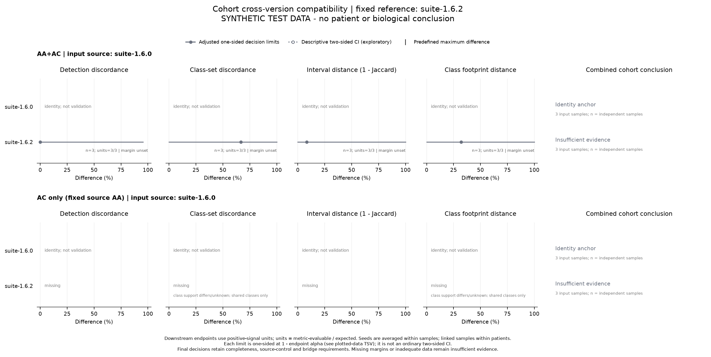

# AmpliconSuite Cross-Version Concordance

[English](README.md) · [示例输入](examples) · [服务器步骤](docs/server_quickstart.md) · [统计方法](docs/statistical_methods.md) · [更新日志](#更新日志)

**以有限计算比较不同版本的扩增结果，输出逐样本天梯图和有明确证据边界的兼容性报告。**

版本 **0.4.4.dev2**。固定参考为 **Suite 1.6.2 / AA 1.6.r2 / AC 2.0.1**，不会随上游更新自动改变。本项目是独立开发的本地科研工具，不属于官方AmpliconSuite组件。

> 相似度只描述已观察到的软件输出，不是生物学真实性概率，也不证明完整流程可互换。允许差异未预设、样本不足或证据不完整时，结论保留为“证据不足”。

## 固定区域使用官方 Suite 默认参数

新清单在顶层使用 `"parameter_policy": "suite_defaults"`。这一路径采用锁定的官方 Suite 配方。AA 使用 `FULL`、`EXPLORE` 和 Suite 默认 10× 下采样，求解器按各版原生许可检查选择。Concordance 不设置 Python 哈希种子。AC 采用各版原生分类阈值，筛种阈值为增益 4.5、最小 50,000 bp。Concordance 记录实际调用及是否复用了原生背景统计。Concordance 会先按锁定 AA 版本的缓存规则核对覆盖度统计。AA 自行重算后，只要断点图、环和访问审计通过，AC 就会继续。每次的缓存决定和处理结果见 `aa_background.json`。

输入仍为既有候选区域。局部 CNVkit 的有限窗口和背景属于研究设计，完整 Suite 的全基因组发现与全 BAM 质量检查不在此流程范围内。固定种子、100 Mb 上限和报告格式照旧。官方模式要求删除 `aa_parameters`、`ac_parameters` 中的覆盖项和运行环境中的求解器/哈希种子覆盖。用新输出目录运行，避免混合不同条件。

## 固定种子的 AA 重建提速（0.4.3）

自定义参数模式沿用 0.4.3 的 `CYCLES` 默认值 和 `EXPLORE`，输出断点图数据、环和摘要，供各版 AC 分类以及生成样本和队列报告。需要额外的 AA 原生结构变异图时，在清单中设置 `"aa_parameters": {"runmode": "FULL", "downsample": -1}`，将示例的下采样值换为本次比较原定值。

同一 AA 提交、有效运行环境、种子、BAM、参考、背景统计、参数和读取限制均匹配时，多套 Suite 可共用一次 AA 重建。各套 Suite 使用配套 AC。逐版本执行记录可追溯复用来源，`stage_timing.tsv` 提供各阶段计时和缓存命中情况。超过区段访问预算时，报告保留失败状态和日志。

查看 `stage_timing.tsv` 时，以同一个 `invocation_id` 为一次运行。`accounting=invocation_total` 是整次耗时；筛选 `measurement_kind=subprocess` 可查看 AA、AC 及局部 CNVkit 等实际调用。AA 原生日志中的部分阶段会重叠，`producer_reference` 引用以前运行的耗时。这两类行都不应累加到本次总耗时。

升级时选用新输出目录。第一次运行用来测量冷启动耗时，原命令可用于中断续跑。若只调整 AC 参数，在新清单顶层填入 `reuse_aa_from` 指向之前 0.4.3 的运行目录，并使用新输出目录。将新运行的分阶段耗时、每版返回状态与旧记录配对比较。

## 以原 CNVkit 版本为局部对照（0.4.2）

每个 `with_bam` 样本使用**生成该输入时的 CNVkit 版本**作为局部标准。例如原来用 0.9.14，则先局部运行 0.9.14，再与各目标 CNVkit 比较。双方使用相同的 BAM、正常参考策略、候选、侧翼、背景、分箱和分段设置，种子筛选统一使用**来源 Suite 的 AA 筛种器**。多套 Suite 共用一个目标 CNVkit 时，按一个版本比较。

来源结果目录中的单份 `*_run_metadata.json` 可提供原 CNVkit 执行命令和版本，也可在样本清单或 TSV 填写精确的 `source_cnvkit_version`。声明与原始执行记录冲突时显示来源不可用。如果所需环境不在已配置的 Suite 环境中，把解释器与脚本路径登记到共享 `cnvkit_runtimes`。额外目标通过可选的 `local_cnv.comparison_versions` 指定。[配置示例及校准方法](docs/local_cnv_calibration.md)

打开 `result.md`，同时看**标准和目标各自保留多少原候选**，以及两者在原候选内的种子区段 Jaccard。两个版本可以彼此很像，同时各自仅保留少量原候选。`local_cnv_comparator_samples.tsv` 给出可配对数、目标额外保留数、遗漏数和保留率差；整组表给出按患者或独立样本汇总的描述性区间。运行失败、来源未知、双方均无区段信号分别显示。原生 Suite 配方比较沿用固定参考 Suite 1.6.2，正式兼容判定及原候选再保留校准另有证据要求。

下游的原始 AA 区段、AC 分类区段和完整/共同类别标签一致率见 `result.tsv`。可从完整性校验通过的 0.4.3、0.4.2 或已支持的 0.3.0～0.4.1 旧记录重绘报告。旧记录只呈现已保存的指标，新对照标记为 `not_recorded_in_run`；获得实测值需用新目录运行 `with_bam`。

```sh
asconcordance report --from-run runs/comparison --out reports/comparison-0.4.3
```

[来源复现和参数对照步骤](docs/source_reproduction.md)

## 两种输入方式

| 模式 | 输入 | 能做什么 |
|---|---|---|
| `with_bam` | 已有AA/AC结果、来源Suite版本、最终种子BED、排序BAM及现成索引、匹配参考资源 | 局部复核全部已有候选；固定抽取少量种子运行各版AA＋AC，上下游分别报告并作限定范围汇总 |
| `results_only` | 已有AA/AC结果、来源Suite及参考版本声明，无需BAM | 比较已提供的多个版本结果；配置AC环境后，也可在同一原AA图上重新分类 |

**无BAM且只有一套AA结果时，不能重跑其他AA版本。** 此时只检验不同AC在相同AA重建上的分类表现；未提供的AA版本显示未验证。导入的版本信息属于声明与源码锁的核对，不冒充历史环境实测。

局部CNVkit需要明确的背景窗口BED。默认 `matched_normal` 还需配对正常BAM及索引；只有肿瘤BAM时，可显式设 `local_cnv.reference_mode="flat"`。程序不会静默切换，邻近区域或平坦参考也不自动等于可靠正常背景。

## 快速开始

Python 包名为 `ampliconsuite-cross-version-concordance`。请在新的虚拟环境安装，然后使用 `asconcordance` 命令。

在解压后的仓库根目录运行；当前面向Linux/macOS：

```sh
python3 -m venv .venv
. .venv/bin/activate
python -m pip install .
asconcordance --help
asconcordance versions
asconcordance demo --out demo_output
```

查看 `demo_output/report.md`。Demo自行生成明确标记的人工结果，走真实导入、统计和绘图入口；不需要患者数据、BAM或AA/AC环境，**不执行真实AA/AC，不构成患者结论**。重复生成demo须使用新输出目录。

需要Python≥3.10、NumPy、SciPy、Matplotlib、pysam。安装本包只安装比较程序依赖，不包含AA、AC、CNVkit、参考资源或商业求解器许可。也可通过 `python -m ascompare.concordance` 使用程序。

## 配置真实输入

- [多个版本既有结果](examples/concordance.results_only.json)：无需BAM和算法环境。
- [仅一套结果，重做AC](examples/concordance.ac_only.json)：需配置对应AC及参考资源。
- [已有结果＋BAM](examples/concordance.with_bam.json)：需配置精确AA/AC/CNVkit环境。

```sh
cp examples/concordance.results_only.json concordance.local.json
# 编辑concordance.local.json，填写实际本地路径、来源版本及分析参数。
asconcordance check --manifest concordance.local.json --out runs/comparison
asconcordance run --manifest concordance.local.json --out runs/comparison
asconcordance report --out runs/comparison
```

相对路径以清单文件所在目录为准。原文件只读，输出必须与输入/参考目录分开。可显式指定 `aa_dir`、`ac_dir`，也支持规范化 `run_dir` 或可识别的Suite `result_dir`；目录有歧义时不猜测。尽量保留graph、cycles、summary、分类profile与feature BED，只有图片或分类标签不足以完成比较。

`check` 检查清单、坐标、BAM 头、现成索引和小型结果文件格式。`import_format_check.tsv` 显示每份导入的表头、文件计数以及匹配问题。`run`另核验真实组件版本和源码，缺环境/失败不替换为最新版。`report` 重绘同程序版本的完整性已核验结果。升级后的计算请使用新输出目录。报告成功生成不等于所有科学计算成功，须同时查看运行覆盖率和异常记录。

[服务器步骤](docs/server_quickstart.md)说明多版本配置；[依赖说明](docs/environment_setup.md)说明历史环境；[局部CNV校准](docs/local_cnv_calibration.md)说明原始来源证据要求。

## 一批样本输入与整组报告（0.4.0）

一张本地 TSV 样本表配一份共享 JSON 配置，按样本首次出现顺序逐例处理，无需改变样本名或使用固定输出文件夹名称。

```sh
asconcordance import-samples --samples samples.tsv --config batch.json --out batch.manifest.json
asconcordance check --manifest batch.manifest.json --out runs/batch01
asconcordance run --manifest batch.manifest.json --out runs/batch01
```

有 BAM 的模板为 [样本表](examples/samples.with_bam.tsv) + [共享配置](examples/batch.with_bam.json)；无需 BAM 的模板为 [已有结果表](examples/samples.results_only.tsv) + [共享配置](examples/batch.results_only.json)。模板是人工占位路径，运行前填写实际数据及环境。[完整列说明、路径规则和批量步骤](docs/batch_input.md)。

打开 `sample_reports.md` 查看全部样本图，`report.md` 查看整组统计。新增 `cohort_compatibility.*` 同时显示实际失配指标、区间、预设允许差异、独立样本或患者数及联合判定，精确绘图数据保存在 `cohort_compatibility_metrics.tsv`。填写 `patient_id` 后按患者聚合；来源版本不同和仅 AC 分别报告。每例图展示观察差异，单个样本不作总体等效判断。`sample_progress.tsv` 保存串行进度和故障样本。

## 计算范围与默认值

**不进行全基因组BAM操作。** 不运行CNVkit batch/autobin，不全基因组发现种子，不排序、重建索引、转换CRAM、运行全文件BAM统计或完整读取BAM求哈希。BAM及索引须在程序外准备好。

上游只测已有候选、两侧延伸和明确背景。下游所有版本使用同一份冻结的随机抽样种子，保留AA必要的有限背景估计和向相连区域扩展的能力。种子是待检查候选，不能直接当成已确认扩增。超出读取预算时明确失败，不将截断结构标记为成功。

| 参数 | 默认值 | 说明 |
|---|---:|---|
| `sampling.max_seeds` | 10/样本 | 下游最多选取数量，不足则全取；上游仍检查全部已有候选 |
| `sampling.random_seed` | 20261117 | 查看新结果前固定抽样 |
| `local_cnv.flank_bp` | 100,000 | 每侧延伸长度 |
| `local_cnv.bin_size` | 1,000 | 局部覆盖度窗口长度 |
| `local_cnv.max_window_bp` | 25,000,000 | 合并窗口总长度上限 |
| `local_cnv.min_seed_overlap` | 1.0 | 原候选被保留种子区间覆盖的比例要求 |
| `statistics.min_samples` | 20 | 保守操作门槛，不保证检验效能 |
| 兼容允许差异 | 未设 | 不会自动给出兼容通过结论 |

这些是可调工程初值，**不是官方兼容阈值，也不是已证实足够的种子数**。候选覆盖率要求属于匹配规则，不能代替统计容忍度。有限BED和超时限制原生bedcov，无法直接观察其C层内部reads数；执行器不是恶意代码隔离工具。

来源Suite也会重跑选中种子，与原结果核对报告指标。局部校准独立使用来源版本的同版本复现与原运行留存的证据。候选版本的漏种作为结果记录，不影响来源校准。只有来源校准、覆盖与实验条件均满足时，才可形成限定的联合判定。局部重选种子没有全部再次送入AA，联合表属于分步骤条件证据，不是完整端到端发现流程验证。

## 版本面板

内置Suite **1.2.2、1.3.3、1.3.4、1.3.7、1.4.0、1.5.0、1.5.2、1.5.3、1.6.0、1.6.1、1.6.2**。组件表见[英文首页](README.md#locked-component-panel)，来源和限制见[版本证据](docs/version_evidence.md)。

1.5.2 及以前的七版容器配方使用 CNVkit 0.9.10，1.5.3 和三个 1.6.x 版本使用 0.9.13。源码commit、归档和文件清单摘要固定保存，实际环境另核验；镜像名称或Suite标签本身不能证明组件身份。0.9.14 可在与原输入相符时用作局部标准，也可作为额外指定的受控目标。历史AA需要适当Mosek安装与许可证，源码可下载或能启动不等于真实样本已验证。

## 图表、统计与兼容判定


*仅为人工结果示例；没有患者数据，也不是实际AA/AC重跑结果。*

主图比较“输入来源版本→目标版本”，各来源分层；详细报告同时保留固定参考及其他版本之间的比较。自身比较仅是恒等锚点，不是独立验证。

下游分别报告检出、完整标签集合、区段Jaccard和类别所在区段Jaccard；上游单独报告候选保留。历史版本不支持某类别时明确标记，只比较共同支持类别不会显示成完整分类一致。

首页给出配对检出变化（目标－来源，百分点）、区间、新增、遗漏、分类改变和分母。上游另显示双方均可评价候选的保留率差。种子先在样本内平均，填写 `patient_id` 后再在患者内平均，最终患者等权。学习队列设 `statistics.primary_pairs: []` 做描述，验证队列预先锁定版本对和界值。兼容判定以预设容忍度和保守单侧置信界为依据。 [队列学习和阈值选择](docs/cohort_study.md)


- `within_margin`：在已评价范围内支持预设一致性。
- `exceeds_margin`：证据支持至少一个相关指标超过预设范围。
- `insufficient_evidence`：阈值、样本量或其他证据条件不足。

失败、缺件、不支持与未检出分别保存。P＞0.05不等于兼容，全阴性区域不用于抬高结构一致性；高相似度不证明完整断点拓扑、路径顺序或生物学真实性。[完整统计说明](docs/statistical_methods.md)。

## 输出与续跑



| 输出 | 内容 |
|---|---|
| `report.md`、`summary.json` | 配对差异、分母、参考版本与结论范围 |
| `import_format_check.tsv` | `asconcordance check` 的小文件格式核查 |
| `similarity_ladder.*`、`sample_ladders/` | 汇总及逐样本天梯图，PNG/PDF/SVG |
| `sample_reports.md`、`sample_plot_index.tsv`、`sample_similarity.tsv` | 全部样本图链接、观察相似度和状态 |
| `compatibility_table.*`、`compatibility_combined.tsv` | 三态兼容表 |
| `upstream_retention_ladder.*`、`upstream_*.tsv` | 上游保留率、区间与校准状态 |
| `cohort_compatibility.*`、`cohort_compatibility_metrics.tsv` | 整组失配、区间、阈值、独立单位数和统计判定 |
| `sample_progress.json`、`sample_progress.tsv` | 样本处理顺序、进度和结果状态计数 |
| `downstream/` | 分层差异、统计和兼容判定 |
| `local_cnv_comparator_{seeds,samples,cohort}.tsv`、`local_cnv_comparator_cohort.*` | 局部 CNVkit 相对输入同版本的结果、计数、描述性区间及整组图 |
| `sampling/`、`source_bridge/` | 冻结抽样与来源复现检查 |
| `imports/`、`reclassifications/`、`*_jobs/`、`cnv_cache/` | 小型结果副本、日志、中间文件和缓存证据 |
| 各类provenance、版本锁和 `run_metadata.tsv` | 输入身份、资源、实际组件和参数 |

重复同一run命令可续跑。缓存先核对原输出、实际源码/依赖和参数，再重新解析，不直接相信缓存标签。改变清单需新输出目录。BAM采用首、中、尾三段64KiB抽样指纹，不声称全文件完整性校验。

## 更新日志

| 版本 | 主要变化 |
|---|---|
| 0.4.4（开发版） | 新模板按各版官方 Suite 默认值启动选定区域 AA＋AC。 |
| 0.4.3 | 新增分阶段计时，默认用 CYCLES 重建。AA 与 AC 分开缓存，匹配同一 AA 提交和有效输入的 Suite 共用一次重建。 |
| 0.4.2 | 以样本原用的 CNVkit 版本作局部对照，报告种子保留、新增、遗漏和区段重叠。Linux 镜像加入 CNVkit 0.9.14。 |
| 0.4.1 | 新增逐样本结果摘要，列出种子保留比例、AA 与 AC 的区段相似度和标签一致率。符合条件的旧版 AA 可复用已核验的背景统计。 |
| 0.4.0 | 支持用 TSV 样本表批量导入。新增逐样本报告索引、整组兼容性图和进度记录。 |
| 0.3.2 | 采用 MIT 许可证，并支持从校验通过的 0.3.1 结果重绘报告。 |
| 0.3.1 | 项目改名为 AmpliconSuite Cross-Version Concordance，命令改为 `asconcordance`。 |
| 0.3.0 | 版本面板加入 Suite 1.5.3。新增患者分组、配对差异估计和独立来源校准。 |
| 0.2.0 | 有 BAM 时支持局部 CNVkit 和固定种子 AA/AC 对比。无 BAM 时可比较已有结果。 |
| 0.1.0 | 初版原型，可运行多个 Suite 版本，并与固定参考版本比较结果。 |

0.1.0 和 0.4.1 为本地开发版本。

## 验证状态

0.4.3 在人工阳性 BAM 上用原生 AA、AC 完成了全部 11 个 Suite 配方对照。与旧流程逐版比较，断点图数据、环、摘要、分类和特征区段文件逐字节相同。相同条件下共用 AA 后，实际重建由 11 次减至 10 次。[对照记录](docs/validation_status.md)

0.4.2 在本机通过全部 311 项回归。另在一对人工肿瘤和正常 BAM 上固定来源 AA 1.6.r1，以局部 CNVkit 0.9.14 为标准，实际比较了 0.9.10 和 0.9.13。四个历史版本的原生 AA 合成对照及其范围见 [验证记录](docs/validation_status.md)。

0.4.0 批量更新已完成 **257 项本地测试，另 1 项可选集成跳过**。人工数据验证了公共批量导入、串行人工 BAM 调用、失败后继续、中断续跑、患者分组及整组图的精确置信界；这属于程序验证，不是患者兼容结论。

0.3.0 回归覆盖独立校准、患者聚类、探索性比较、配对差异首页和部分原生结果解析。真实 CNVkit 0.9.10 和 0.9.13 已用人工 BAM 验证局部流程。Suite 1.5.3 具备核验过的源码锁和本机组件启动证据。

GitHub Actions 已通过 Python 3.10 和 3.12 的人工数据回归测试，以及 0.3.0 环境的 Linux amd64 测试。真实患者重建和队列兼容仍待验证。 [验证详情](docs/validation_status.md) · [环境和镜像安装说明](https://github.com/YenningC/AmpliconSuite-Cross-Version-Concordance-Environments)

```sh
python -m unittest discover -s tests -v
```

默认测试只创建临时人工输入，不下载上游程序或读取患者数据。真实CNVkit测试需显式配置外部环境。

官方EC-comparator及AC的results_comparator独立适配器继续保留；新asconcordance不自动调用，也不把其分数当兼容阈值。[使用说明](docs/official_comparison_tools.md)。

## 仓库与许可证

程序在 `ascompare/`，测试在 `tests/`，示例在 `examples/`，辅助脚本在 `scripts/`。部分旧模块留作回归测试；旧 `ascompare run/check` 全基因组工作流已禁用，请使用 `asconcordance`。

仓库只包含程序、文档和人工示例，没有患者数据、私有配置、参考基因组、算法环境或求解器许可证。项目原创代码与文档采用 **MIT 开源许可**。第三方组件遵循各自许可。 [MIT 许可证](LICENSE) · [GitHub 上传步骤](GITHUB_UPLOAD.md)
