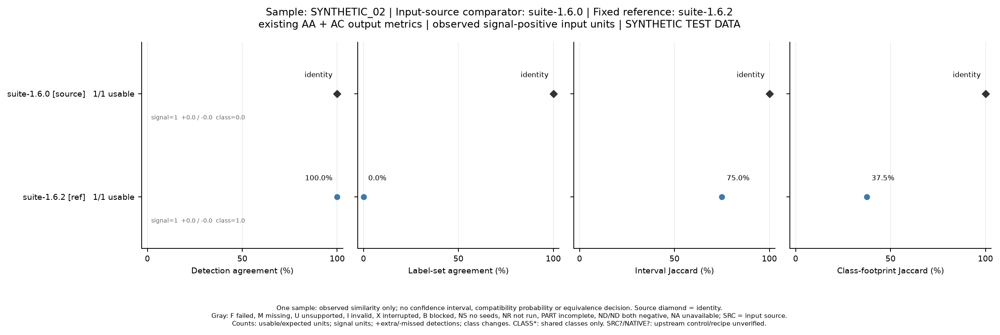

# AmpliconSuite Benchmarks

[English](README.md) · [示例输入](examples) · [服务器步骤](docs/server_quickstart.md) · [统计方法](docs/statistical_methods.md)

**以有限计算比较不同版本的扩增结果，输出逐样本天梯图和有明确证据边界的兼容性报告。**

版本 **0.3.0**。固定参考为 **Suite 1.6.2 / AA 1.6.r2 / AC 2.0.1**，不会随上游更新自动改变。本项目是独立开发的本地科研工具，不属于官方AmpliconSuite组件。

> 相似度只描述已观察到的软件输出，不是生物学真实性概率，也不证明完整流程可互换。允许差异未预设、样本不足或证据不完整时，结论保留为“证据不足”。

## 两种输入方式

| 模式 | 输入 | 能做什么 |
|---|---|---|
| `with_bam` | 已有AA/AC结果、来源Suite版本、最终种子BED、排序BAM及现成索引、匹配参考资源 | 局部复核全部已有候选；固定抽取少量种子运行各版AA＋AC，上下游分别报告并作限定范围汇总 |
| `results_only` | 已有AA/AC结果、来源Suite及参考版本声明，无需BAM | 比较已提供的多个版本结果；配置AC环境后，也可在同一原AA图上重新分类 |

**无BAM且只有一套AA结果时，不能重跑其他AA版本。** 此时只检验不同AC在相同AA重建上的分类表现；未提供的AA版本显示未验证。导入的版本信息属于声明与源码锁的核对，不冒充历史环境实测。

局部CNVkit需要明确的背景窗口BED。默认 `matched_normal` 还需配对正常BAM及索引；只有肿瘤BAM时，可显式设 `local_cnv.reference_mode="flat"`。程序不会静默切换，邻近区域或平坦参考也不自动等于可靠正常背景。

## 快速开始

在解压后的仓库根目录运行；当前面向Linux/macOS：

```sh
python3 -m venv .venv
. .venv/bin/activate
python -m pip install .
asbench --help
asbench versions
asbench demo --out demo_output
```

查看 `demo_output/report.md`。Demo自行生成明确标记的人工结果，走真实导入、统计和绘图入口；不需要患者数据、BAM或AA/AC环境，**不执行真实AA/AC，不构成患者结论**。重复生成demo须使用新输出目录。

需要Python≥3.10、NumPy、SciPy、Matplotlib、pysam。安装本包只安装比较程序依赖，不包含AA、AC、CNVkit、参考资源或商业求解器许可。也可通过 `python -m ascompare.benchmark` 使用程序。

## 配置真实输入

- [多个版本既有结果](examples/benchmarks.results_only.json)：无需BAM和算法环境。
- [仅一套结果，重做AC](examples/benchmarks.ac_only.json)：需配置对应AC及参考资源。
- [已有结果＋BAM](examples/benchmarks.with_bam.json)：需配置精确AA/AC/CNVkit环境。

```sh
cp examples/benchmarks.results_only.json benchmarks.local.json
# 编辑benchmarks.local.json，填写实际本地路径、来源版本及分析参数。
asbench check --manifest benchmarks.local.json --out runs/comparison
asbench run --manifest benchmarks.local.json --out runs/comparison
asbench report --out runs/comparison
```

相对路径以清单文件所在目录为准。原文件只读，输出必须与输入/参考目录分开。可显式指定 `aa_dir`、`ac_dir`，也支持规范化 `run_dir` 或可识别的Suite `result_dir`；目录有歧义时不猜测。尽量保留graph、cycles、summary、分类profile与feature BED，只有图片或分类标签不足以完成比较。

`check` 检查清单、坐标、BAM 头、现成索引和小型结果文件格式。`import_format_check.tsv` 显示每份导入的表头、文件计数以及匹配问题。`run`另核验真实组件版本和源码，缺环境/失败不替换为最新版。`report` 重绘同程序版本的完整性已核验结果。0.2.0 的分析请用原版重绘，升级后的计算使用新输出目录。报告成功生成不等于所有科学计算成功，须同时查看运行覆盖率和异常记录。

[服务器步骤](docs/server_quickstart.md)说明多版本配置；[依赖说明](docs/environment_setup.md)说明历史环境；[局部CNV校准](docs/local_cnv_calibration.md)说明原始来源证据要求。

## 计算范围与默认值

**不进行全基因组BAM操作。** 不运行CNVkit batch/autobin，不全基因组发现种子，不排序、重建索引、转换CRAM、运行全文件BAM统计或完整读取BAM求哈希。BAM及索引须在程序外准备好。

上游只测已有候选、两侧延伸和明确背景。下游所有版本使用同一份冻结的随机抽样种子，保留AA必要的有限背景估计和向相连区域扩展的能力。种子是待检查候选，不能直接当成已确认扩增。超出读取预算时明确失败，不将截断结构标记为成功。

| 参数 | 默认值 | 说明 |
|---|---:|---|
| `sampling.max_seeds` | 10/样本 | 下游最多选取数量，不足则全取；上游仍检查全部已有候选 |
| `sampling.random_seed` | 20261117 | 查看新结果前固定抽样 |
| `local_cnv.flank_bp` | 100,000 | 每侧延伸长度 |
| `local_cnv.bin_size` | 1,000 | 局部覆盖度窗口长度 |
| `local_cnv.max_window_bp` | 25,000,000 | 合并窗口总长度上限 |
| `local_cnv.min_seed_overlap` | 1.0 | 原候选被保留种子区间覆盖的比例要求 |
| `statistics.min_samples` | 20 | 保守操作门槛，不保证检验效能 |
| 兼容允许差异 | 未设 | 不会自动给出兼容通过结论 |

这些是可调工程初值，**不是官方兼容阈值，也不是已证实足够的种子数**。候选覆盖率要求属于匹配规则，不能代替统计容忍度。有限BED和超时限制原生bedcov，无法直接观察其C层内部reads数；执行器不是恶意代码隔离工具。

来源Suite也会重跑选中种子，与原结果核对报告指标。局部校准独立使用来源版本的同版本复现与原运行留存的证据。候选版本的漏种作为结果记录，不影响来源校准。只有来源校准、覆盖与实验条件均满足时，才可形成限定的联合判定。局部重选种子没有全部再次送入AA，联合表属于分步骤条件证据，不是完整端到端发现流程验证。

## 版本面板

内置Suite **1.2.2、1.3.3、1.3.4、1.3.7、1.4.0、1.5.0、1.5.2、1.5.3、1.6.0、1.6.1、1.6.2**。组件表见[英文首页](README.md#locked-component-panel)，来源和限制见[版本证据](docs/version_evidence.md)。

1.5.2 及以前的七版容器配方使用 CNVkit 0.9.10，1.5.3 和三个 1.6.x 版本使用 0.9.13。源码commit、归档和文件清单摘要固定保存，实际环境另核验；镜像名称或Suite标签本身不能证明组件身份。0.9.14只可作为明确标记的受控条件。历史AA需要适当Mosek安装与许可证，源码可下载或能启动不等于真实样本已验证。

## 图表、统计与兼容判定



*仅为人工结果示例；没有患者数据，也不是实际AA/AC重跑结果。*

主图比较“输入来源版本→目标版本”，各来源分层；详细报告同时保留固定参考及其他版本之间的比较。自身比较仅是恒等锚点，不是独立验证。

下游分别报告检出、完整标签集合、区段Jaccard和类别所在区段Jaccard；上游单独报告候选保留。历史版本不支持某类别时明确标记，只比较共同支持类别不会显示成完整分类一致。

首页给出配对检出变化（目标－来源，百分点）、区间、新增、遗漏、分类改变和分母。上游另显示双方均可评价候选的保留率差。种子先在样本内平均，填写 `patient_id` 后再在患者内平均，最终患者等权。学习队列设 `statistics.primary_pairs: []` 做描述，验证队列预先锁定版本对和界值。兼容判定以预设容忍度和保守单侧置信界为依据。 [队列学习和阈值选择](docs/cohort_study.md)


- `within_margin`：在已评价范围内支持预设一致性。
- `exceeds_margin`：证据支持至少一个相关指标超过预设范围。
- `insufficient_evidence`：阈值、样本量或其他证据条件不足。

失败、缺件、不支持与未检出分别保存。P＞0.05不等于兼容，全阴性区域不用于抬高结构一致性；高相似度不证明完整断点拓扑、路径顺序或生物学真实性。[完整统计说明](docs/statistical_methods.md)。

## 输出与续跑

| 输出 | 内容 |
|---|---|
| `report.md`、`summary.json` | 配对差异、分母、参考版本与结论范围 |
| `import_format_check.tsv` | `asbench check` 的小文件格式核查 |
| `similarity_ladder.*`、`sample_ladders/` | 汇总及逐样本天梯图，PNG/PDF/SVG |
| `sample_plot_index.tsv`、`sample_similarity.tsv` | 图索引、观察相似度和状态 |
| `compatibility_table.*`、`compatibility_combined.tsv` | 三态兼容表 |
| `upstream_retention_ladder.*`、`upstream_*.tsv` | 上游保留率、区间与校准状态 |
| `downstream/` | 分层差异、统计和兼容判定 |
| `sampling/`、`source_bridge/` | 冻结抽样与来源复现检查 |
| `imports/`、`reclassifications/`、`*_jobs/`、`cnv_cache/` | 小型结果副本、日志、中间文件和缓存证据 |
| 各类provenance、版本锁和 `run_metadata.tsv` | 输入身份、资源、实际组件和参数 |

重复同一run命令可续跑。缓存先核对原输出、实际源码/依赖和参数，再重新解析，不直接相信缓存标签。改变清单需新输出目录。BAM采用首、中、尾三段64KiB抽样指纹，不声称全文件完整性校验。

## 验证状态

0.3.0 回归覆盖独立校准、患者聚类、探索性比较、配对差异首页和部分原生结果解析。真实 CNVkit 0.9.10 和 0.9.13 已用人工 BAM 验证局部流程。Suite 1.5.3 具备核验过的源码锁和本机组件启动证据。

现有公开镜像通过了固定 0.2.0 源码的 Linux 测试。真实患者重建、队列兼容和 0.3.0 的托管 Linux 测试仍待验证。 [验证详情](docs/validation_status.md) · [机器可读记录](validation_summary.json)

```sh
python -m unittest discover -s tests -v
```

默认测试只创建临时人工输入，不下载上游程序或读取患者数据。真实CNVkit测试需显式配置外部环境。

官方EC-comparator及AC的results_comparator独立适配器继续保留；新asbench不自动调用，也不把其分数当兼容阈值。[使用说明](docs/official_comparison_tools.md)。

## 仓库与许可证

程序在 `ascompare/`，测试在 `tests/`，示例在 `examples/`，辅助脚本在 `scripts/`。部分旧模块留作回归测试；旧 `ascompare run/check` 全基因组工作流已禁用，请使用 `asbench`。

仓库只包含程序、文档和人工示例，没有患者数据、私有配置、参考基因组、算法环境或求解器许可证。使用项目原创代码须按已公开的声明取得事先书面许可。申请联系人见该声明。第三方组件遵循各自许可。 [授权声明](LICENSE_STATUS.md) · [GitHub 上传步骤](GITHUB_UPLOAD.md)
